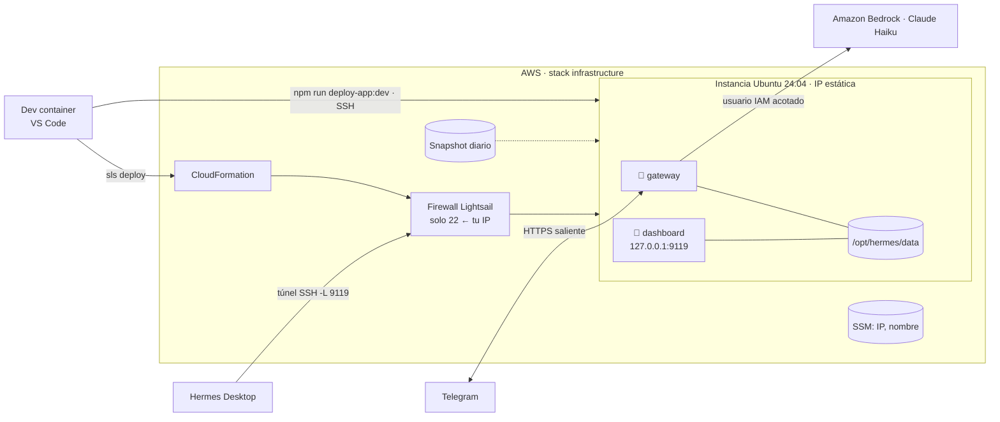

# Hermes Agent

## Arquitectura



| Pieza                     | Dónde                                      | Qué hace                                                                                                                      |
| ------------------------- | ------------------------------------------ | ----------------------------------------------------------------------------------------------------------------------------- |
| **Dev container**         | `.devcontainer.json`, `.docker/`           | Imagen con Node, Python, AWS CLI, Serverless, cfn-lint y Claude Code. Es donde se ejecuta todo lo demás                       |
| **Infraestructura**       | `serverless/infrastructure`                | Instancia Lightsail, IP estática, firewall (22 → tu IP), snapshot diario, parámetros SSM; el user data instala Docker         |
| **Contenedor del agente** | `app/`                                     | `Dockerfile` (imagen oficial `nousresearch/hermes-agent` + paquetes extra) y `docker-compose.yml` con `gateway` y `dashboard` |
| **Despliegue**            | `scripts/lightsail.sh`, `app/env.template` | Renderiza `app/.env`, sube un _release_ por SSH, construye y levanta los contenedores                                         |

**Modelo: Claude Haiku en Amazon Bedrock** (`us.anthropic.claude-haiku-5-5`, sin API key de terceros). Como una
instancia de Lightsail no puede tener rol de IAM, el stack crea un usuario IAM solo con permiso para invocar ese
modelo (`iam.yml`) y guarda su clave en Secrets Manager (`secrets-manager.yml`); `deploy-app` la lee y la
manda al servidor.

Los **secretos que tú escribes no pasan por CloudFormation**: el user data y la plantilla son legibles; el token
de Telegram viaja solo en `app/.env` (0600) durante el despliegue.

### Estructura

```text
hermes-agent-lightsail/
├── .devcontainer.json        # VS Code dev container
├── .docker/                  # dev container: Dockerfile, docker-compose.yml, initialize.sh, entrypoint.sh, aws.sh
├── .envs/                    # aws.env, sls.env, config.env (ignorados por git)
├── app/                      # lo que se despliega a Lightsail
│   ├── Dockerfile
│   ├── docker-compose.yml
│   ├── env.template          # variables que viajan al servidor
│   ├── env.sh                # env.template → .env (envsubst)
│   └── skills/               # skills de Hermes versionadas (se montan en /opt/skills)
├── serverless/infrastructure/
│   ├── serverless.yml, lightsail.yml, ssm.yml
│   ├── user-data.sh          # bootstrap de la instancia (Docker, swap)
│   ├── allowed-cidrs.js      # ALLOWED_SSH_CIDR → firewall (vacío = SSH abierto)
│   └── downloadSshKeyPair.sh # llave por defecto de Lightsail → ~/.ssh
├── scripts/lightsail.sh      # deploy, rollback, status, logs, chat, model, ssh, tunnel
├── docs/                     # architecture.drawio (diagrama de arquitectura, draw.io)
├── .claude/                  # reglas, agente y skills de Claude Code para este repo
└── CLAUDE.md, changelog.md, cspell.json, ws.code-workspace, package.json
```

## Comandos npm

Todos se ejecutan dentro del dev container (orden de despliegue en el [README](../README.md#deployment)). Los de operación actúan sobre el stage cuyos archivos de
`.envs` cargó el contenedor (cada stage vive en su propia cuenta de AWS). Encuentran la
instancia por SSM con las credenciales de `.envs/aws.env`, así que no guardan IPs.

**Infraestructura** (Serverless Framework: `sls deploy|remove --stage <stage>` en `serverless/infrastructure`):

| Comando                                        | Qué hace                                                                                                                                                            |
| ---------------------------------------------- | ------------------------------------------------------------------------------------------------------------------------------------------------------------------- |
| `npm run deploy-infra:dev` / `:test` / `:prod` | Crea o actualiza el stack: instancia Lightsail, IP estática, firewall, snapshot diario, usuario IAM de Bedrock y su secreto, parámetros SSM. Descarga la llave SSH. |
| `npm run remove-infra:dev` / `:test` / `:prod` | Borra el stack: la instancia, la IP, los datos de `/opt/hermes/data` y los snapshots automáticos. Haz antes un snapshot manual si el estado importa.                |

**Agente** (`scripts/lightsail.sh`, por SSH):

| Comando                                      | Qué hace                                                                                                                                                              |
| -------------------------------------------- | --------------------------------------------------------------------------------------------------------------------------------------------------------------------- |
| `npm run deploy-app:dev` / `:test` / `:prod` | Genera `app/.env`, sube un release nuevo de `app/`, construye la imagen, levanta `gateway` y `dashboard` y fija Bedrock como modelo. Conserva los 3 últimos releases. |
| `npm run rollback`                           | Vuelve al release anterior y lo levanta.                                                                                                                              |
| `npm run releases`                           | Lista los releases del servidor y cuál está activo (`current`).                                                                                                       |
| `npm run status`                             | Muestra el estado de los contenedores y del gateway de Hermes.                                                                                                        |
| `npm run logs`                               | Sigue en vivo el log del gateway (Telegram, llamadas al modelo). `Ctrl+C` para salir.                                                                                 |
| `npm run chat`                               | Abre la CLI interactiva de Hermes dentro del contenedor.                                                                                                              |
| `npm run model`                              | Abre el selector de modelo de Hermes (si `deploy-app` no pudo fijar Bedrock).                                                                                         |
| `npm run ssh`                                | Abre una sesión SSH en la instancia como `ubuntu`.                                                                                                                    |
| `npm run tunnel`                             | Abre un túnel `localhost:9119` → dashboard del servidor (desde el dev container; reenvía el puerto en VS Code para usarlo en el Mac).                                 |
| `npm run token`                              | Imprime el token de sesión del dashboard que pide Hermes Desktop. Cambia con cada reinicio o `deploy-app`.                                                            |
| `npm run ip-lightsail`                       | Imprime la IP pública de la instancia (de SSM).                                                                                                                       |
| `npm run key`                                | Descarga de nuevo la llave SSH de Lightsail de la región a `~/.ssh`.                                                                                                  |
| `npm run myip`                               | Imprime tu IP pública como `/32`, para ponerla en `ALLOWED_SSH_CIDR`.                                                                                                 |

**Calidad del repositorio:**

| Comando                | Qué hace                                                        |
| ---------------------- | --------------------------------------------------------------- |
| `npm run format`       | Formatea con prettier (yml, md, json) y reescribe los archivos. |
| `npm run format:check` | Comprueba el formato sin cambiar nada.                          |
| `npm run spell`        | Revisa la ortografía con cspell (inglés y español).             |

## Conectar Hermes Desktop (Mac) con el VPS

El dashboard de Hermes escucha solo en `127.0.0.1:9119` de la instancia (ningún puerto abierto
a internet). La app de escritorio llega a él por un túnel SSH. Por loopback el dashboard no pide
un proveedor de login, pero sí un **token de sesión** que genera al arrancar y que cambia con cada
reinicio o `deploy-app`. El navegador lo toma solo de la página; Hermes Desktop lo pide.

1. Instala Hermes Desktop desde <https://hermes-agent.nousresearch.com/>.
2. En el dev container, obtén la IP de la instancia:

   ```bash
   npm run ip-lightsail
   ```

3. En la **Terminal del Mac** (no en el dev container), abre el túnel y déjala abierta. La llave
   ya está en el Mac, en `~/.ssh-hermes` (el dev container la monta desde ahí). Si tu región no
   es `us-east-1`, cambia el nombre del archivo:

   ```bash
   ssh -i ~/.ssh-hermes/hermes-agents.lightsail.us-east-1.pem -N -L 9119:127.0.0.1:9119 ubuntu@<IP>
   ```

   No imprime nada: así debe quedar. `Ctrl+C` cierra el túnel.

4. Comprueba el túnel abriendo <http://localhost:9119> en el navegador del Mac: debe aparecer la
   interfaz web de Hermes.
5. En el dev container, obtén el token de sesión del dashboard:

   ```bash
   npm run token
   ```

6. En Hermes Desktop: **Settings → Gateways → Add connection → Remote gateway**, URL
   `http://localhost:9119` y el token del paso anterior.

Después de cada `npm run deploy-app:<stage>` (o si el contenedor se reinicia) el token cambia:
repite el paso 5 y pon el nuevo token en Desktop.

Alternativa sin la Terminal del Mac: `npm run tunnel` en el dev container y reenviar el puerto
`9119` en la pestaña _Ports_ de VS Code.

Si `localhost:9119` no carga: revisa que el túnel siga abierto, que `npm run status` muestre
`hermes-dashboard` en `Up` y que el puerto 9119 del Mac no esté ocupado (`lsof -i :9119`).

> Verificado en el servidor: sin token la API del dashboard responde 401 y con él 200 (como
> `Authorization: Bearer` o `X-Hermes-Session-Token`). Sin verificar: los nombres exactos del menú
> de Desktop.
